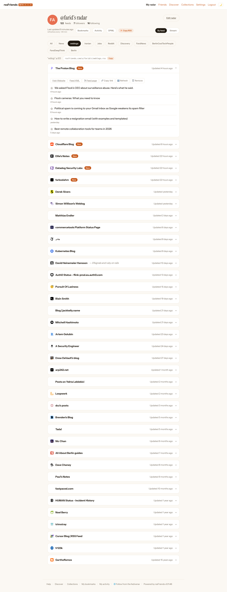
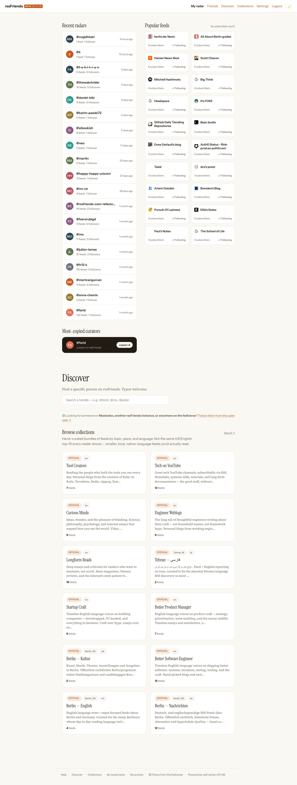

# FediverseRssFriends

> **⚠️ This is a Proof of Concept.** It is a clean copy of **rssFriends**, made so anyone can run their own instance. The main website is **[rssfriends.com](https://rssfriends.com)**. If you just want to use the app, go there. If you want to run it on your own server, keep reading.

## What it is

FediverseRssFriends is a small web app for people who read RSS feeds together.

You can:

- Add RSS or Atom feeds and put them in your own categories.
- Share your list of feeds on a public page.
- Follow other people and see what they save and read.
- Save (bookmark) items you like.
- Get your own reading list back out as an RSS feed.
- Follow users on Mastodon and other rssFriends servers, and let them follow you back. This uses **ActivityPub**, the protocol Mastodon uses.

There is no unread count, no big backlog, and no algorithm. You just see what's new from the people and sites you chose.

## Tech

- **FastAPI** (Python web framework) + **HTMX** (light frontend) + **Jinja2** (templates)
- **SQLite** for storage (one file)
- **APScheduler** for background refresh
- Managed with **uv** (Python package manager)

No JavaScript build step. No Redis. No worker process. One Docker container.

## Run your own in 15 minutes

You need a small server, a domain name, and Docker.

```bash
git clone https://github.com/pesarkhobeee/FediverseRssFriends.git /srv/rssfriends
cd /srv/rssfriends
cp .env.example .env
# Open .env and set at least:
#   RSSFRIENDS_HOSTNAME       (your domain, e.g. rss.mydomain.com)
#   RSSFRIENDS_INSTANCE_NAME  (short name shown in the top bar)
#   RSSFRIENDS_SESSION_SECRET (a long random string)
docker compose -f docker-compose.prod.yml up -d --build
```

Full guide with DNS, Caddy, backups, and federation checks:
[`docs/self-host.md`](docs/self-host.md).

## Docs

- [`docs/self-host.md`](docs/self-host.md) — set up on a VPS from zero
- [`docs/configuration.md`](docs/configuration.md) — every environment variable
- [`docs/instance-config.md`](docs/instance-config.md) — server name, admin, open registration
- [`docs/federation-activitypub.md`](docs/federation-activitypub.md) — how Mastodon federation works here
- [`docs/operations.md`](docs/operations.md) — backup, restore, admin queries
- [`docs/wallabag.md`](docs/wallabag.md) — optional Wallabag save-later integration
- [`docs/design-language.md`](docs/design-language.md) — colors and visual style
- [`docs/deploy.md`](docs/deploy.md) — how the deploy pipeline works
- [`KNOWN_ISSUES.md`](KNOWN_ISSUES.md) · [`SECURITY.md`](SECURITY.md)

## Develop

You need [uv](https://docs.astral.sh/uv/) installed.

```bash
uv sync --all-extras
uv run uvicorn app.main:app --reload   # opens http://localhost:8000
uv run pytest -q                       # run tests
uv run ruff check .                    # run linter
```

## Screenshots

Your public reading page. Other people can visit it and follow your feeds:



The Discover page. It shows recent users, popular feeds, and a list of curated collections you can browse:



## License

MIT.

Visual style was inspired by [lovelyRSS](https://github.com/pesarkhobeee/lovelyRSS).
